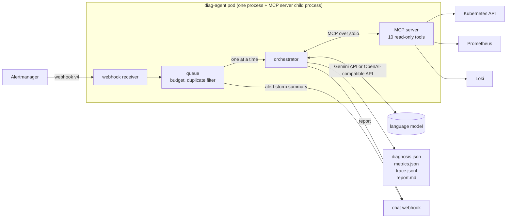

# Architecture

## Components

The same investigation can be started in two ways: by an alert, inside the cluster (`cmd/diag-agent`), or by hand
for one alert (`cmd/agent`, used by the scenario runner to compare methods on the same fault). Both call
`investigate.Run`, so they are the same code.

| Component | Code | Role |
|---|---|---|
| In-cluster agent | `cmd/diag-agent` | One process in the cluster: Alertmanager webhook receiver, queue, a single worker that runs the investigations, and a built-in chat stand-in. With `AUTO_INVESTIGATE=false` it only records alerts. |
| Alert receiver | `internal/receiver` | `POST /alerts` (Alertmanager webhook v4), `GET /alerts`, `GET /healthz`, and a bounded store of notifications. |
| Queue with a budget | `internal/watch/queue.go` | Accepts at most 5 investigations per 10 minutes (`QUEUE_BUDGET`, `QUEUE_WINDOW`), at most 20 pending, one at a time in arrival order; duplicate filter; one summary message for the alerts over the budget (below). |
| Investigation runner | `internal/investigate` | One diagnosis from start to finish: picks the model client, starts the MCP server, runs the agent loop or the pipeline, writes the result files, posts the report. Shared by `cmd/agent` and `cmd/diag-agent`. |
| Orchestrator | `internal/agent/agent.go` | The investigation loop and all guards (below). Talks to a `Model` and to a `Tools` interface, so both can be faked in tests. |
| MCP client | `internal/agent/mcpclient.go` | Starts the MCP server, lists its tools, keeps only allow-listed ones and turns them into function declarations for the model. |
| MCP server | `cmd/mcp-server`, `internal/mcpserver`, `internal/tools` | Exposes the read-only tools over MCP (stdio), using the official Go SDK. |
| Model clients | `internal/agent/gemini.go`, `openai.go`, `apfel.go` | Gemini Interactions API; the on-device apfel model; any other OpenAI-compatible server (`--provider openai`). |
| Pipeline | `internal/agent/pipeline.go` | The "fixed sequence + one model call" method (`--mode pipeline`). |
| Rule baseline | `internal/rules` | Seven if-then rules (R1-R7) over the fixed sequence's evidence; no model. |
| Report and message | `internal/notify` | Human-readable report (`report.md`) and the Slack-style webhook message to the on-call engineer. |
| Host-side watcher | `internal/watch/watch.go`, `labctl watch` | The automatic path with the agent on the host: polls the receiver for new firing lab alerts, one investigation at a time, 30 min duplicate filter. |
| Lab | `internal/lab`, `internal/evidence`, `internal/scenario`, `cmd/labctl` | Cluster access (isolated kubeconfig on a workstation, service account inside a pod), the fixed evidence sequence, scenario runner, three-part judge, local chat stand-in. |

## Three methods, compared on the same fault

| Method | Who collects the data | Who concludes | Model calls |
|---|---|---|---|
| `rules` | fixed sequence A1-A11 | rules R1-R7 (known failure classes) | 0 |
| `pipeline` | fixed sequence A1-A11 | the model, once, no tools | 1 |
| `agent` | the model, through the 10 MCP tools | the model | several (at most 15 tool calls) |

The comparison answers two design questions. Does the model add anything: on the known classes (S1-S3) a rule
fires, so a model can only add something where no rule does (S4-S7). Is the loop needed: the fixed sequence
inspects only the alerted object, so only the agent can move to another workload (S5, S6). The method
`agent-incluster` is the agent loop started by the alert inside the cluster instead of by the scenario runner.
The measured outcomes are in [results.md](results.md).

## One investigation

1. The receiver gets a notification. In the cluster, every firing alert that passes the queue is handed to the
   worker; on the command line `cmd/agent` is given one alert (a webhook payload or a single alert JSON).
2. The runner starts the MCP server, lists the tools and sends the model the system prompt, the tool
   declarations and the alert.
3. The model asks for a tool call. The orchestrator checks the allow-list and the duplicate filter, runs the call
   through MCP, wraps the result as `<tool_output id="tN" untrusted="true">...</tool_output>` and sends it back.
   Step 3 repeats until the model stops asking.
4. The model answers with one JSON object. The orchestrator validates it (below); an invalid answer is sent back
   once for repair, then the run fails with `invalid_diagnosis`. An accepted answer goes through the content check.
5. The runner writes `diagnosis.json`, `metrics.json` (tool calls, rejected calls, repairs, duration, tokens,
   stop reason, model id, prompt id, generation parameters, truncated results, content check), `trace.jsonl`
   (alert, every tool call with its full result, final answer) and `report.md`, and posts the report to the
   chat webhook.

Stop reasons: `diagnosis`, `invalid_diagnosis`, `call_budget`, `timeout`, `model_error`, `empty_step`,
`rejected_budget`.

### The procedure in the prompt

The system prompt (`internal/agent/prompt.go`) is generic: it describes a triage procedure and the answer format,
never a scenario or its cause. The procedure has six steps:

- a. identify the target (list the pods if the alert names only a service);
- b. check the pod status;
- c. check the rollout history of the pod's Deployment;
- d. confirm with an independent source (events, logs or metrics);
- e. if the alerted workload looks healthy, follow the dependency to the workloads that call it or that it calls;
- f. when moving to another workload, check that workload's rollout history too. A change is the cause only if it
  belongs to the workload whose logs or metrics show the fault and was rolled out shortly before the alert started.

Step f was added on 2026-11-16. The first evaluation showed the model reading the rollout history of the alerted
workload only and blaming an unrelated older change there. To make the timing comparable, `get_rollout_history`
now also returns `last_rollout_at` (a ReplicaSet reused by a rollback keeps its old creation time, so the
creation time alone does not tell when a revision was rolled out). The earlier prompt is kept as `SystemPromptV1`
and is selected with `AGENT_PROMPT=v1` (Gemini provider) only for a control comparison on the same faults. Every
run records which prompt it used: `prompt` in `metrics.json` is the first 8 hex digits of the SHA-256 of the
system prompt.

### Answer validation

Two checks with different consequences:

| Check | Code | What it proves | On failure |
|---|---|---|---|
| Structure and citations | `ParseDiagnosis` | the answer matches the schema, the category is in the enum, every evidence item cites a tool call that actually ran, every command has `requires_human_approval: true` | the answer is **rejected**: one repair attempt, then `invalid_diagnosis` |
| Content (numbers) | `CheckGrounding` in `grounding.go` | every number quoted in an evidence item occurs in the tool result that item cites; every number in the explanation or summary occurs in some tool result or in the alert | the answer is **kept and flagged**: `grounding` in `metrics.json`, and a "Not verified automatically" line in the chat message |

The content check needs no model. It looks at numbers of two or more digits that do not continue a word (so
`9899`, `exitCode=137` and `128Mi` count, `p95` and `t12` do not). It only flags, because a number can be
rephrased correctly (128Mi for 134217728 bytes). It does not check facts without numbers, so it narrows the gap
between "cites a real call" and "the cited result says this", it does not close it.

### The queue in the cluster

`internal/watch/queue.go` answers what happens when many alerts arrive at once:

- only firing alerts are taken, and the lab's self-test alert (severity `none`) is ignored;
- the duplicate filter is keyed by fingerprint and `startsAt`: a repeated notification of the same firing is a
  duplicate, an alert that fires again after being resolved has a new `startsAt` and is a new incident;
- at most `QUEUE_BUDGET` investigations are accepted per `QUEUE_WINDOW` (default 5 per 10 minutes) and at most 20
  wait, so an alert storm costs a bounded number of model calls;
- alerts over the budget are not dropped silently: the engineer gets one "Alert storm" message per notification
  that lists them as not investigated, and they appear as `skipped` in `GET /investigations`.

`labctl storm [N]` sends N synthetic alerts in one notification to observe this.

## The tools

Ten tools, none of which writes. Arguments are validated before any API call (Kubernetes names must match the
DNS-1123 pattern, so a model cannot reach `../kube-system`), and every result is capped at 8 KB.

| Tool | Returns |
|---|---|
| `list_pods` | pods of a namespace with phase and restart count (max 50) |
| `get_pod_status` | phase, conditions, container states, restart counts, resource limits |
| `get_events` | latest events of an object (max 20) |
| `get_container_logs` | last log lines of a container (max 50 lines, 8 KB) |
| `get_rollout_history` | owner workload, latest revisions, change cause, `last_rollout_at`, diff of the two newest pod templates |
| `get_resource_usage` | memory and CPU usage, memory limit, restarts, last termination reason (Prometheus) |
| `get_service_endpoints` | services selecting the pod and how many endpoints are ready |
| `get_node_status` | node conditions and allocatable resources |
| `query_logs` | LogQL query against Loki (max 60 minutes, 50 lines) |
| `query_metrics` | instant PromQL query against Prometheus (max 20 rows) |

`internal/evidence` implements the same checks as a fixed sequence of 11 read-only actions (A1-A11). It is the
baseline the agent is compared against: it always makes 20 calls, whatever the alert is.

## Threat model

What the agent treats as untrusted:

| Input | Why | What limits the damage |
|---|---|---|
| The alert text | labels and annotations come from whoever can write alert rules or post to the webhook | it is data in the first user turn; names taken from it are validated before any API call |
| Tool results (logs, events, metrics) | container logs and events contain text that users of the application control (a request header ends up in a log line) | wrapped as `<tool_output untrusted="true">`, the prompt forbids following instructions found there; levels 1, 2 and 4 hold even if the model is fooled |
| The model's answer | the model can be wrong, or be talked into something by the two inputs above | validated before it is used; it can only become a message for a person |

What is trusted: the **tool descriptions**. The MCP server is first-party code, built from this repository into
the same image and started by the agent as a child process over stdio. No third-party MCP server is connected, so
a tool description cannot carry instructions from someone else. This is the deliberate answer to tool poisoning.

### Four protection levels

1. **Cluster permissions.** The agent's ServiceAccount (`env/manifests/diag-agent.yaml`) has only `get`, `list`
   and `watch`, and no access to `secrets`, `pods/exec`, `pods/portforward` or `services/proxy`. `make check`
   verifies allowed and forbidden verbs with SubjectAccessReview.
2. **MCP server.** Only the 10 tools exist; there is no generic command tool. Inputs are validated and results
   are capped.
3. **Orchestrator.** Allow-list of tool names, a budget of tool calls and time (15 calls / 180 s; 8 calls /
   300 s for the local model), a duplicate-call filter, and tool output marked as untrusted data (logs and events
   are attacker-influenced text and must not be followed as instructions).
4. **Output.** The answer must match `docs/schemas/diagnosis.schema.json`, the category must be in the enum,
   every evidence item must cite a tool call that actually ran, and every next step that has a command must have
   `requires_human_approval: true`. The agent only proposes; a person decides.

Levels 3 and 4 are enforced in code (`ParseDiagnosis`, `Agent.Investigate`) and covered by tests with a scripted
fake model, independently of which model is used. Scenario S7 (see [scenarios.md](scenarios.md)) exercises all
four with an instruction planted in a container log.

### Residual risks

- **A wrong diagnosis caused by indirect prompt injection.** The levels above guarantee that nothing in the
  cluster changes and that no command leaves the agent without the human-approval flag. They do not guarantee
  that the model ignores planted text: it can still name the wrong cause, and the person who reads the report
  can be misled. The content check flags quoted numbers only.
- **Logs leave the cluster.** With a hosted model, everything the tools return (container logs, events, metrics)
  is sent to the model provider. There is no redaction layer; secrets printed into logs would be sent as well.
  An OpenAI-compatible server inside the cluster avoids this.
- **Egress is restricted by address, not by name** (see Deployment).

## Deployment

`make agent-deploy` builds the image and applies `env/manifests/diag-agent.yaml`:

- **Image.** `Dockerfile.agent` is `FROM scratch` with two static binaries, `/diag-agent` and `/mcp-server`, and
  nothing else: no shell, package manager or interpreter. CA root certificates are embedded in the binary, so
  HTTPS to the provider is verified without a system bundle.
- **Pod hardening.** Deployment `diag-agent`, one replica (the queue and the duplicate filter are in memory): runs
  as non-root (uid 65532), read-only root filesystem, no privilege escalation, all capabilities dropped, seccomp
  `RuntimeDefault`. The only writable path is an `emptyDir` at `/work` (limit 256Mi) for the traces.
- **Identity.** ServiceAccount `diag-agent` bound to the read-only ClusterRole `diag-agent-readonly` (level 1).
  Inside the pod the MCP server uses this service account and reaches Prometheus and Loki at their Service
  addresses, not through the API server proxy, so the account needs no `services/proxy` right.
- **Secret.** `GEMINI_API_KEY` (and `NOTIFY_WEBHOOK_URL`, if set) come from the Secret `diag-agent-llm`, created
  by `make agent-secret` from `.env`. The key is neither in the manifest nor in the image, and the agent's own
  account cannot read Secrets.
- **NetworkPolicy.** Ingress to port 8080 only from Alertmanager and from the node network (kubelet probes, and
  the lab tooling that reads results through the API server proxy). Egress only to DNS, the Kubernetes API,
  Prometheus, Loki and HTTPS (port 443) outside the private address ranges (the model provider and the chat
  webhook). The application namespaces are not reachable, so the agent cannot call the services it diagnoses.
  A standard NetworkPolicy selects by IP block, not by host name: narrowing the HTTPS rule to the provider's
  name needs a CNI with FQDN policies (for example Cilium). `make netpol-check` starts a probe pod with the
  agent's label and prints PASS or FAIL for allowed and blocked destinations.
- **Service.** Still named `alert-receiver`, because Alertmanager is configured with that address.

HTTP endpoints of the pod: `POST /alerts`, `GET /alerts`, `GET /investigations`,
`GET /investigations/{id}/{file}` (`trace.jsonl`, `diagnosis.json`, `metrics.json`, `report.md`), `POST /sink` and
`GET /messages` (the built-in chat stand-in, used when `NOTIFY_WEBHOOK_URL` is empty), `GET /healthz`.

## Answer schema

`docs/schemas/diagnosis.schema.json` (embedded into the binary by `docs/embed.go`) is the only definition of the
answer, used both to constrain the model and to validate its output. Categories: `OOMKilled`, `ApplicationCrash`,
`ImagePullError`, `ConfigurationError`, `ProbeFailure`, `Scheduling`, `NodeProblem`, `DependencyFailure`,
`Unknown`. The `metrics` block is added by the orchestrator, never by the model.

## Isolation of the lab

All lab commands use their own kubeconfig (`.kube/config` in the repository) and force the `kind-kursinis`
context, so a work cluster in `~/.kube/config` is never read or changed. Scenarios reach Prometheus, Loki,
Alertmanager and the in-cluster agent through the API server proxy, so no port-forward is needed.
