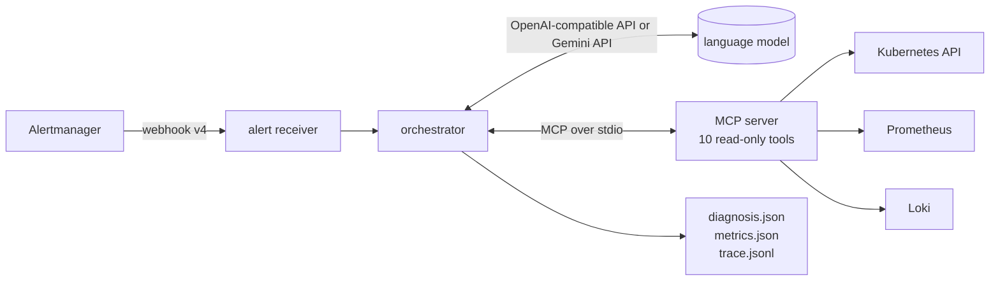

# Architecture

## Components

| Component | Code | Role |
|---|---|---|
| Alert receiver | `cmd/alert-receiver`, `internal/receiver` | Accepts Alertmanager webhook v4 notifications in the cluster and keeps a bounded store. Standard library only, runs `FROM scratch`. |
| Orchestrator | `internal/agent/agent.go` | The investigation loop and all guards (below). Talks to a `Model` and to a `Tools` interface, so both can be faked in tests. |
| MCP client | `internal/agent/mcpclient.go` | Starts the MCP server, lists its tools, keeps only allow-listed ones and turns them into function declarations for the model. |
| MCP server | `cmd/mcp-server`, `internal/mcpserver`, `internal/tools` | Exposes the read-only tools over MCP (stdio), using the official Go SDK. |
| Model clients | `internal/agent/gemini.go`, `openai.go` | Gemini Interactions API, and any OpenAI-compatible server (used for apfel). |
| Lab | `internal/lab`, `internal/evidence`, `internal/scenario`, `cmd/labctl` | Isolated cluster access, a fixed evidence sequence used as a baseline, scenario runner and judge. |

## One investigation

1. The receiver gets an alert. `cmd/agent` is given one alert (a webhook payload or a single alert JSON).
2. The orchestrator starts the MCP server, lists the tools and sends the model the system prompt, the tool
   declarations and the alert.
3. The model asks for a tool call. The orchestrator checks the allow-list and the duplicate filter, runs the call
   through MCP, wraps the result as `<tool_output id="tN" untrusted="true">...</tool_output>` and sends it back.
   Step 3 repeats until the model stops asking.
4. The model answers with one JSON object. The orchestrator validates it; an invalid answer is sent back once
   for repair, then the run fails with `invalid_diagnosis`.
5. The orchestrator writes `diagnosis.json`, `metrics.json` (tool calls, rejected calls, repairs, duration,
   tokens, stop reason, model id) and `trace.jsonl` (alert, every tool call, final answer).

Stop reasons: `diagnosis`, `invalid_diagnosis`, `call_budget`, `timeout`, `model_error`, `empty_step`,
`rejected_budget`.

## The tools

Ten tools, none of which writes. Arguments are validated before any API call (Kubernetes names must match the
DNS-1123 pattern, so a model cannot reach `../kube-system`), and every result is capped at 8 KB.

| Tool | Returns |
|---|---|
| `list_pods` | pods of a namespace with phase and restart count (max 50) |
| `get_pod_status` | phase, conditions, container states, restart counts, resource limits |
| `get_events` | latest events of an object (max 20) |
| `get_container_logs` | last log lines of a container (max 50 lines, 8 KB) |
| `get_rollout_history` | owner workload, latest revisions, change cause, diff of the two newest pod templates |
| `get_resource_usage` | memory and CPU usage, memory limit, restarts, last termination reason (Prometheus) |
| `get_service_endpoints` | services selecting the pod and how many endpoints are ready |
| `get_node_status` | node conditions and allocatable resources |
| `query_logs` | LogQL query against Loki (max 60 minutes, 50 lines) |
| `query_metrics` | instant PromQL query against Prometheus (max 20 rows) |

`internal/evidence` implements the same checks as a fixed sequence of 11 read-only actions (A1-A11). It is the
baseline the agent is compared against: it always makes 20 calls, whatever the alert is.

## Safety layers

1. **Cluster permissions.** The agent's ServiceAccount (`env/manifests/diag-agent.yaml`) has only `get`, `list`
   and `watch`, and no access to `secrets`, `pods/exec` or `pods/portforward`. `make check` verifies this with
   SubjectAccessReview.
2. **MCP server.** Only the 10 tools exist; there is no generic command tool. Inputs are validated and results
   are capped.
3. **Orchestrator.** Allow-list of tool names, a budget of tool calls and time (15 calls / 180 s; 8 calls /
   300 s for the local model), a duplicate-call filter, and tool output marked as untrusted data (logs and events
   are attacker-influenced text and must not be followed as instructions).
4. **Output.** The answer must match `docs/schemas/diagnosis.schema.json`, the category must be in the enum,
   every evidence item must cite a tool call that actually ran, and every next step that has a command must have
   `requires_human_approval: true`. The agent only proposes; a person decides.

Items 3 and 4 are enforced in code (`ParseDiagnosis`, `Agent.Investigate`) and covered by tests with a scripted
fake model, independently of which model is used.

## Answer schema

`docs/schemas/diagnosis.schema.json` (embedded into the binary by `docs/embed.go`) is the only definition of the
answer, used both to constrain the model and to validate its output. Categories: `OOMKilled`, `ApplicationCrash`,
`ImagePullError`, `ConfigurationError`, `ProbeFailure`, `Scheduling`, `NodeProblem`, `DependencyFailure`,
`Unknown`. The `metrics` block is added by the orchestrator, never by the model.

## Isolation of the lab

All lab commands use their own kubeconfig (`.kube/config` in the repository) and force the `kind-kursinis`
context, so a work cluster in `~/.kube/config` is never read or changed. Scenarios reach Prometheus, Loki and
Alertmanager through the API server proxy, so no port-forward is needed.
